# Görüntü, Ses ve Ortam Sensörlerinin Derin Füzyonuyla Eksik Modaliteye Dayanıklı Ev Doluluk Tespiti

**Vize Teknik Raporu: Veri Toplama, İnceleme, Temizleme ve Keşifsel Analiz**

**Hazırlayan:** Kerem Emre Gümüştaş (231307084) · **Ders:** Derin Öğrenme · **Teslim tarihi:** 19.11.2026

Multimodal dönem projesi · Veri seti: HPDmobile (University of Colorado Boulder & Iowa State University)
Kod ve yeniden üretim: `https://github.com/ksilverstone/hpdmobile-doluluk-tespiti`

---

## Özet

Bu çalışmada bir evin içinde 10 saniyelik bir zaman diliminde kaç kişi bulunduğunu üç sınıfta (0 / 1 / 2+) tahmin
edecek multimodal bir derin öğrenme modelinin veri aşaması yürütülmüştür. HPDmobile veri setinin altı evine ait
görüntü (32×32 gri kare), ses (10 saniyelik ses zarfı) ve ortam sensörü (sıcaklık, nem, ışık, eCO2, TVOC) verileri 50,9 GB
sıkıştırılmış ham veriden indirilmiş, ortak 10 saniyelik bir zaman ızgarasında eşleştirilmiş ve 1.311.925 etiketli örnek
elde edilmiştir (0 kişi 402.967, 1 kişi 478.068, 2+ kişi 430.890). Analiz; fiziksel olarak imkânsız sensör okumaları, takılı
bir nem sensörü, sistematik ortam veri boşlukları, gece karanlığından kaynaklanan sistematik görüntü eksikliği (hub başına ortalama hub-pencerelerin
%30,9'u), kamera otomatik pozlaması ve kişi sayısı etiketinin doğrulanmamış olması gibi sorunları sayısallaştırmıştır.
Temizleme ve ön işleme adımları (aralık dışı değer silme, kısa boşluk doldurma, log dönüşümü, hub bazlı normalizasyon)
öncesi/sonrası grafiklerle belgelenmiştir. EDA, sınıf ile günün saati arasında güçlü bir karışıklık (H1'de 2+ sınıfı
gece %86,4, öğlen %31,0), ışık sensörü ile kamera parlaklığı arasında modaliteler arası yüksek uyum (medyan Spearman ρ = 0,84)
ve ardışık pencereler arasında çok yüksek zamansal bağımlılık (%99,95 aynı etiket) göstermiştir. Bu bulgular nedeniyle veri
bölme stratejisi olarak rastgele katlama yerine ev bazlı (leave-one-home-out) 6 katlı çapraz doğrulama ve zamansal iç
doğrulama seçilmiştir.

**Anahtar kelimeler:** multimodal öğrenme, doluluk tespiti, sensör füzyonu, eksik modalite, veri kalitesi, keşifsel veri analizi

---

## 1. Problem Tanımı ve Multimodal Yapı (Kriter 1)

### 1.1 Problem ve motivasyon

Binalar dünyadaki nihai enerji tüketiminin yaklaşık %30'unu oluşturur; bunun yaklaşık %70'i konutlardadır ve gelişmiş
ekonomilerde konut enerjisinin yaklaşık %70'i ısıtma ve sıcak suya gider (IEA, 2025). Konutlarda tüketilen enerjinin
yaklaşık yarısı ısıtma-soğutma-havalandırma (HVAC), yaklaşık %10'u aydınlatmadır (Tan ve ark., 2022). Evde kimse
yokken ısıtmayı kısan doluluk tabanlı kontrol, 8 evlik bir çalışmada ortalama %28 enerji tasarrufu sağlamıştır; aynı
çalışmada basit sensörlü ticari yöntem 8 evin 4'ünde tüketimi artırmıştır (Lu ve ark., 2010). Yani tasarruf, doluluğun
**doğru** algılanmasına bağlıdır. 20 aylık bir saha testinde doluluk tabanlı kontrol %17,6 tasarruf etmiş, fakat ticari
doluluk sensörü uyuyan kişiyi gece neredeyse hiç algılayamamıştır (gece yanlış negatif oranı ~%100) ve bu konforu
bozmuştur (Pang ve ark., 2024). Bu proje, tek sensörün kör kaldığı durumlarda (gece, karanlık, sessizlik) diğer
sensörlere dayanarak çalışabilen çok sensörlü bir model için veriyi hazırlar. Görev, **çok sınıflı sınıflandırmadır**:

- **Girdi:** bir evdeki 4–5 sensör kutusundan (hub) aynı 10 saniyelik pencereye ait görüntü, ses ve ortam ölçümleri.
- **Çıktı:** kişi sayısı sınıfı **y ∈ {0 kişi, 1 kişi, 2+ kişi}**.
- **Kullanım bağlamı:** doluluğa duyarlı HVAC ve aydınlatma kontrolü; kişi sayısı ayrıca havalandırma ihtiyacını belirler.

Veri setindeki kişi sayısı (`number`, 0–5) 0 / 1 / 2+ olarak üç sınıfa indirgenmiştir (`cls = min(number, 2)`).
Ham dağılım 0: 402.967, 1: 478.068, 2: 205.767, 3: 135.087, 4: 47.510, 5: 42.526 penceredir. Gerekçeler
(`reports/sinif_gerekcesi.md`, `src/eda.py tab05`):

- **Etiket sensörden değil, giriş-çıkış kaydından gelir.** Sakinler eve girip çıkarken telefon uygulaması (geo-fence) ve
  kâğıt listeyle kayıt tutmuş, misafirler de eklenmiştir; kişi sayısı yazarlarca doğrulanmamıştır (Jacoby ve ark., 2021).
  Sakin sayısını aşan değerler misafirdir: H3'te (4 sakin) 23.07–04.08.2019 arasında her gün 8–12 saat "5 kişi"
  (42.526 pencere), H2'de (1 sakin) 26.03.2019'da 1,5 saat "2 kişi" (541 pencere). 5 kişi yalnız tek evde ve tek bir
  misafir döneminde vardır; ayrı sınıf olarak genellenemez.
- **Sensörler 2'den sonrasını ayırt edemez.** Kutular yalnız ortak alanlara konmuş, evin %28–58'ini görür (yatak odası
  ve banyo yok). Gündüz en az bir kamerada insan görülen pencere oranı 1 kişide %14,7, 2 kişide %32,3'tür; ama 3 kişide
  %32,1, 4+ kişide %33,7 ile 2 kişiden farksızdır. Yani 1 ile 2 arası gözlenebilir bir fark taşır, 2/3/4 arası taşımaz.
- **Ev bazlı genelleme.** 3 ve üzeri yalnız 3 evde (H1, H3, H4), 4 ve üzeri yalnız 2 evde vardır. Her seferinde bir evin
  test edildiği bölmede (Bölüm 7) bu sınıflar çoğu katta ya testte ya eğitimde hiç bulunmaz.
- **Denge ve yönerge.** Üç sınıf %30,7 / %36,4 / %32,8 ile dengelidir; yönergenin "en az 3 sınıf" koşulunu sağlar.

Aynı tablo gece için bir uyarı da içerir: 00–06 arasında 2 ve üzeri kişide kamerada insan görülme oranı %0,7–2,6'dır,
çünkü insanlar izlenmeyen yatak odalarındadır. Gece 1 ile 2+ ayrımı doğrudan gözlenemez; modelin bunu saatten
öğrenme riski Bölüm 3.3 ve 6.5'te tartışılmıştır. Finalde 0/1/2/3+ dört sınıflı bir deneme ek analiz olarak yapılabilir.

Projenin final aşamasındaki iddiası "eksik modaliteye dayanıklılık"tır: Bölüm 4.3'te gösterildiği gibi gerçek evlerde
görüntü gece karanlıkta, ses ve ortam ise donanım kesintilerinde eksiktir. Model, eksik kanalı tanıyıp kalanlarla tahmin
yapabilmelidir.

### 1.2 Modaliteler

Tablo 1, her modalitenin ham ve işlenmiş biçimini özetler.

**Tablo 1.** Modalitelerin tanımı.

| Modalite | Taşıdığı bilgi | Ham biçim ve sıklık | İşlenmiş biçim (pencere başına, hub başına) | Karakteristik |
|---|---|---|---|---|
| Görüntü | odada görünür insan, ışık durumu | 32×32 gri PNG, saniyede 1 (orijinal 336×336, gizlilik için küçültülmüş) | 1 kare, `[32, 32] uint8` | karanlık kareler yazarlarca atılmış → gece sistematik eksik |
| Ses | konuşma, hareket, cihaz gürültüsü | 10 sn'de 800 değerlik ses zarfı (anlaşılır konuşma içermez) | `[800] float16`, log1p | değer aralığı 0–3,5·10⁸, çok çarpık |
| Ortam | ışık, insan kaynaklı ısı/nem/gaz | sıcaklık, bağıl nem, ışık, eCO2, TVOC; 10 sn | `[5] float32` | yavaş değişen zaman serisi, kesintili |
| Etiket | doluluk | `occupied` (0/1, doğrulanmış), `number` (0–5, tahmin); 10 sn | `cls` ∈ {0, 1, 2} | ev düzeyinde, tüm hub'lar için ortak |

Şekil 1, aynı 10 saniyelik pencereye ait üç modaliteyi ve etiketi yan yana gösterir: her satır farklı sınıftan bir örnektir.

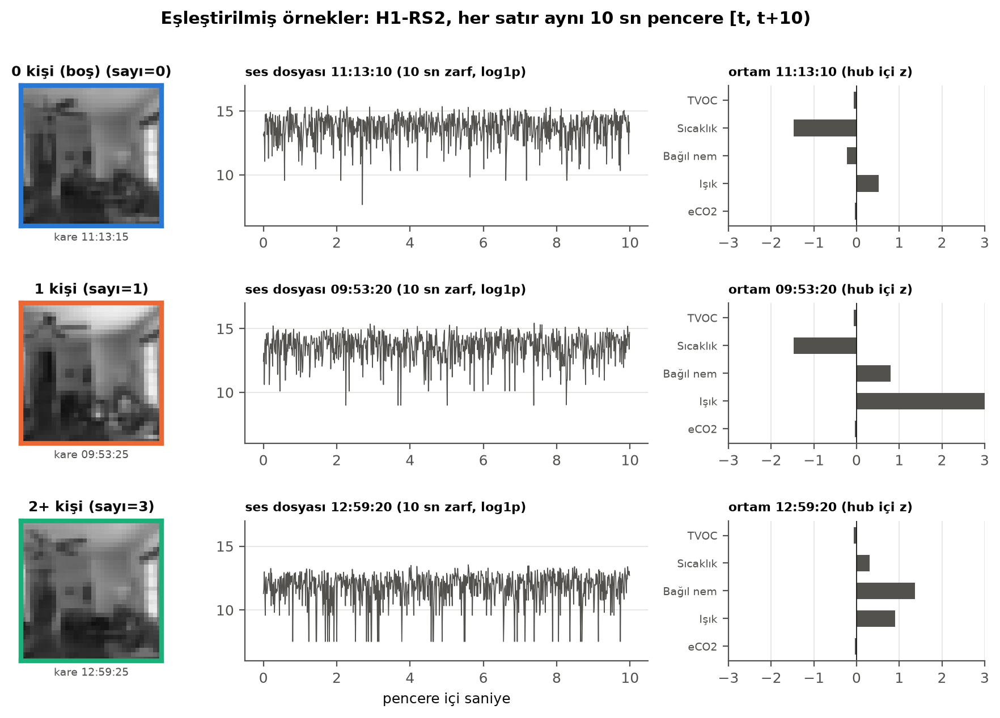

**Şekil 1.** Eşleştirilmiş örnekler (H1 evi, RS2 hub'ı). Sol: pencerenin ortasındaki kare; orta: aynı pencerenin ses zarfı;
sağ: aynı anın ortam ölçümleri (hub içi z-skoru). Karelerin zaman damgası pencere başlangıcından tam 5 sn sonradır.

### 1.3 Multimodal yaklaşımın gerekçesi

Her modalitenin tek başına sınırlılığı veriyle gösterilmiştir:

- **Görüntü:** hub-pencerelerin ortalama %30,9'unda kare karanlık olduğu için yoktur (Şekil 7) ve bu boşluk 2+ sınıfının
  yoğunlaştığı geceye denk gelir (Şekil 5). Kamera yalnız kendi görüş alanını görür: kişi başka odadaysa kare boş görünür.
  32×32 çözünürlükte insan kaba bir leke olarak seçilir (Şekil 2).
- **Ortam:** ışık en ayırt edici ortam değişkenidir (Şekil 12) ama bilgisi büyük ölçüde günün saati üzerinden gelir; gaz
  sensörleri zamanın %35–100'ünde ölçüm tabanındadır (Şekil 13).
- **Ses:** karanlıkta da çalışır ama sınıflar arası farkı küçüktür ve periyodik arka plan gürültüsü baskındır (Şekil 14, 16).

Modaliteler birbirini tamamlar: görüntünün kaybolduğu gece pencerelerinde ses ve ortam ölçümü sürer (Şekil 16'da 00:00–07:00).
Aynı olaya dair modaliteler arası ilişki Bölüm 6.3'te gösterilmiştir: kamera parlaklığı ile ışık sensörü yüksek uyumludur
(Şekil 15) ve bir günlük zaman çizgisinde ışığın açılması, kamera parlaklığının artması ve kamerada insan görülmesi eş
zamanlıdır (Şekil 16). Modaliteler aynı ev, aynı zaman ve aynı hedef (kişi sayısı) için ölçüldüğünden iki ayrı veri setinin
yan yana konması değil, tek bir olayın farklı sensörlerle kaydıdır.

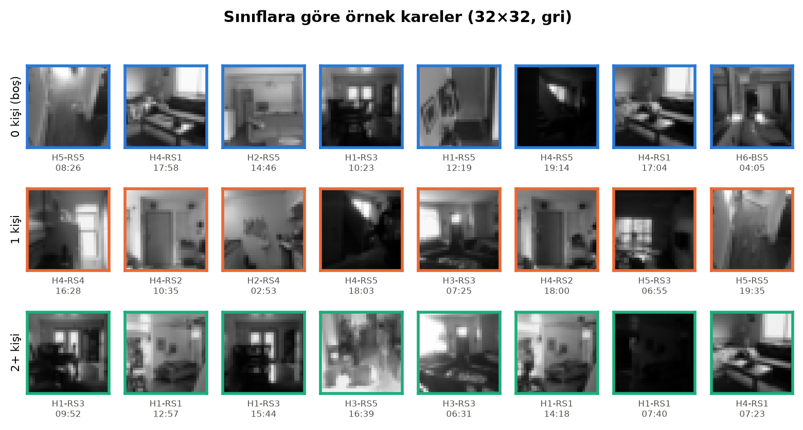

**Şekil 2.** Her sınıftan rastgele 8 kare (farklı ev ve hub'lardan). *Gözlem:* 32×32 karede insan ancak kaba bir siluet;
sahneler arası (oda, açı, aydınlık) fark, sınıflar arası farktan büyüktür. *Önemi:* görüntü modeli kişiyi değil odayı
öğrenebilir. *Modele etkisi:* ev bazlı bölme zorunludur (Bölüm 7) ve görüntü kodlayıcısı küçük, düzenlileştirilmiş olmalıdır.

---

## 2. Veri Kaynakları ve Veri Toplama Süreci (Kriter 2)

### 2.1 Kaynak, lisans ve etik

- **Kaynak:** HPDmobile veri seti, figshare koleksiyonu 5364449 (58 dosya, toplam 50,9 GB zip).
- **Yayın:** Jacoby ve ark. (2021), *Scientific Data* 8, 280.
- **Lisans:** veri CC0 (kamu malı), makale CC BY 4.0.
- **Toplama:** 2019'da Boulder, Colorado'da 6 tek ailelik konut, ev başına en az bir ay, her evde 4–5 hub.
- **Etik:** yazarlar gizlilik için görüntüleri 336×336'dan 32×32'ye küçültmüş, sesi konuşma anlaşılmayacak biçimde ses
  zarfına dönüştürmüştür. Bu projede kişisel veri toplanmamıştır.
- **Evlerin sakinleri (metadata):** H1 4 yetişkin + kedi, H2 1 yetişkin, H3 4 yetişkin + köpek, H4 3 yetişkin,
  H5 2 yetişkin + kedi, H6 1 yetişkin.

### 2.2 Veri edinme yöntemi

Görüntü zip'lerinin içinde yaklaşık 41 milyon küçük PNG bulunur; açılmış hâli 250 GB'ı aşar ve çalışma bilgisayarının
boş alanını (~60 GB) geçer. Bu yüzden zip dosyaları **hiç klasöre açılmadan** işlenmiştir:

1. `src/download.py` figshare API'sinden dosya listesini alır; küçük dosyaları (etiket, ortam, zone etiketi, karanlık liste,
   metadata; ~190 MB) indirir.
2. `src/build.py --fetch` her büyük zip'i (görüntü hub başına, ses ev başına) sırayla indirir, dosyaları zip'in içinden
   bellekte okur, 10 saniyelik ızgaraya hizalanmış dizileri `data/processed/<ev>/` altına yazar ve zip'i siler.
3. Sunumda ham örnek göstermek için her evden 1 saatlik ham görüntü ve ses `data/samples/` altına çıkarılır
   (toplam 533 MB, 100.714 dosya).

Sonuçta 50,9 GB ham veri yerine 15 GB işlenmiş veri kalıcı olarak tutulur. Kullanılan alt küme: altı evin tamamı, bütün
hub'lar, bütün günler. Hiçbir ev veya gün seçilerek dışarıda bırakılmamıştır. Karşılaşılan sorunlar ve çözümleri
`docs/VERI_SORUNLARI.md` dosyasında tarih sırasıyla kayıtlıdır (özet: Tablo 9).

### 2.3 Veri bütünlüğü ve izlenebilirlik

- **Dosya adlandırma:** her ham dosyanın adında tarih, saat, hub ve ev bulunur, ör. `2019-11-26_143005_RS2_H1.png`.
  Zaman damgası dosya adından ayrıştırılır; ayrıştırılamayan dosya sayısı 0'dır.
- **Örnek kimliği:** (ev, pencere indeksi). Pencere indeksi t, etiket dosyasındaki t. satırdır ve [t, t+10 sn) aralığını
  temsil eder. Bütün diziler bu satır sırasıyla yazılır, dolayısıyla `img[i]`, `aud[i]`, `env[i]` ve `labels[i]` aynı ana aittir.
- **Birleştirme kuralı:** zaman damgası 10 saniyeye aşağı yuvarlanır ve etiket ızgarasında aranır (`build.grid_index`).
  Izgarada karşılığı olmayan dosya "ızgara dışı" olarak sayılır ve düşer.
- **İzlenebilirlik:** her ev için ham, eşleşen ve düşen sayılar `data/processed/<ev>/stats.json`'a yazılır. Bu rapordaki
  tablolar bu dosyalardan kodla üretilir (`python src/eda.py tab01`); elle sayı yazılmamıştır.

**Tablo 2.** Başlangıçtaki veri miktarı ve analiz dışı bırakılan kayıtlar (6 ev, 28 hub kaydının toplamı).

| Modalite | Ham kayıt | Analiz dışı (neden) | Kullanılan | Oran |
|---|---|---|---|---|
| Etiket | 1.311.925 satır | 0 | 1.311.925 pencere | %100 |
| Ortam | 5.996.160 satır (ölçümsüz boş satırlar dahil) | 0 tekrar; ölçümsüz satırlar eksik sayıldı | 5.795.480 hub-penceresinde en az bir ölçüm | %95,3 (6.084.425 hub-penceresinin) |
| Görüntü | 40.848.391 kare | 2.037.924 ızgara dışı; 0 bozuk; pencere başına 1 kare seçimi | 3.901.461 hub-penceresinde 1 kare | %64,1 |
| Görüntü (karanlık) | 20.301.472 kare | yayıncı tarafından atılmış; yalnız zamanları listeli | — (eksik modalite olarak sayıldı) | — |
| Ses | 5.313.026 dosya | 6.423 ızgara dışı; 0 bozuk; 0 tekrar | 5.306.603 hub-penceresi | %87,2 |

Izgara dışı kayıtlar, etiket dosyalarında karşılığı olmayan zamanlara aittir. Örneğin H1'de 30 tam gün 259.200 satır
ederken etiket ızgarası 257.845 satırdır; yazarlar bazı saat ve günleri yayımlamamıştır. Ev × hub × modalite kırılımı
`reports/veri_ozeti.md`'dedir (Ek A).

---

## 3. Veri Miktarı, Dağılım ve Temsil Gücü (Kriter 3)

### 3.1 Veri miktarı ve yeterlilik

Eşleştirme sonrası nihai örnek sayısı **1.311.925** penceredir (Tablo 3). Yönerge koşulu (≥3 sınıf, sınıf başına ≥150,
toplam ≥500) fazlasıyla sağlanmıştır: en küçük sınıf (0 kişi) 402.967 örnek içerir.

**Tablo 3.** Ev bazında örnek ve sınıf sayıları.

| Ev | Gün | Hub | Pencere | 0 kişi | 1 kişi | 2+ kişi |
|---|---|---|---|---|---|---|
| H1 | 30 | 5 | 257.845 | 45.921 | 58.866 | 153.058 |
| H2 | 17 | 4 | 146.880 | 58.150 | 88.189 | 541 |
| H3 | 35 | 5 | 302.400 | 65.800 | 55.632 | 180.968 |
| H4 | 17 | 5 | 146.880 | 26.928 | 72.499 | 47.453 |
| H5 | 15 | 5 | 129.600 | 31.606 | 49.124 | 48.870 |
| H6 | 38 | 4 | 328.320 | 174.562 | 153.758 | 0 |
| **Toplam** | 152 | 28 | **1.311.925** | **402.967 (%30,7)** | **478.068 (%36,4)** | **430.890 (%32,8)** |

Not: H6 hub'ları BS2–BS5, diğer evlerinkiler RS1–RS5 adını taşır (H2'de RS3 yok).

### 3.2 Sınıf ve özellik dağılımları

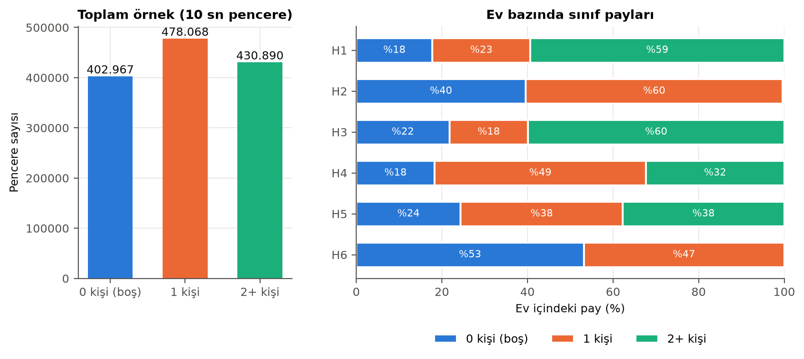

**Şekil 3.** Toplam ve ev bazında sınıf dağılımı. *Gözlem:* toplamda sınıflar dengeli (%30,7 / %36,4 / %32,8), ancak ev
bazında çok dengesiz: H1 ve H3'te 2+ çoğunluk (%59–60), tek kişilik H2 ve H6'da 2+ neredeyse hiç yok (541 ve 0).
*Önemi:* toplam dengenin ev düzeyinde geçerli olmaması, ev bazlı test katlarında sınıf eksikliği yaratır. *Modele etkisi:*
H2 ve H6 test katlarında 3 sınıflı macro-F1 tanımsızdır; sınıf bazında metrik ve birleşik karışıklık matrisi raporlanacaktır
(Bölüm 7).

Modaliteye özgü yapısal dağılımlar Şekil 4'tedir.

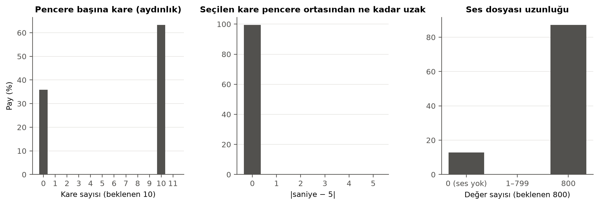

**Şekil 4.** Modalite yapısı. Sol: hub-pencere başına aydınlık kare sayısı. Orta: seçilen karenin pencere ortasından
uzaklığı. Sağ: ses dosyası uzunluğu.

*Gözlem:*
- Pencerelerin %63,3'ünde beklenen 10 karenin tamamı, %35,9'unda hiç kare yok; arası neredeyse hiç yoktur. Eksiklik
  "ya hep ya hiç"tir ve karanlık eşiğiyle açıklanır.
- Seçilen karenin %99,5'i tam pencere ortasındadır (5. saniye).
- Ses dosyalarının hepsi tam 800 değerdir (%87,2); kalan %12,8 hiç ses yoktur, kısmi uzunlukta dosya 0'dır.
- Görüntü boyutu her dosyada 32×32'dir (boyutu farklı dosya 0).

*Önemi:* boyutlar sabit olduğu için yeniden boyutlandırma, kırpma veya dolgu gerekmez; eşleştirme hatası en fazla
1 saniyedir. *Modele etkisi:* her modalite sabit boyutlu tensör olur; eksiklik kısmi değil bütün kanal düzeyinde
modellenir (maske).

Sürekli değişkenlerin sınıf bazında dağılımları Bölüm 6.2'dedir.

### 3.3 Temsil gücü ve olası yanlılıklar

- **Ev ve kişi:** 6 ev, toplam 15 yetişkin; tek bir şehir (Boulder, CO) ve tek ülke. Mimari, iklim ve yaşam tarzı çeşitliliği
  sınırlıdır; sonuçların başka bölgelere genellenmesi doğrulanmamıştır.
- **Zaman:** günün saati ile sınıf güçlü biçimde karışıktır (Şekil 5). Ayrıca evler farklı mevsimlerde ölçülmüştür
  (ör. H2 Mart, H1 Kasım–Aralık, H5 Haziran). Mevsim, ışık ve sıcaklığı sınıftan bağımsız olarak değiştirir.
- **Cihaz:** her hub'ın sensörleri farklı kalibrasyondadır. Ham sıcaklık medyanları hub'lar arasında 23,9–34,0 °C arasında
  değişir (Şekil 11). Aynı fiziksel RS5 kutusu evden eve taşınmış ve nem sensörü arızalıdır (Bölüm 5).
- **Hane yapısı:** 2+ sınıfı yalnız çok kişilik dört evden gelir. Model "2+"yı kişi sayısından değil o evlerin odalarından
  öğrenme riski taşır; ev bazlı bölme bu riski ölçmeyi sağlar.

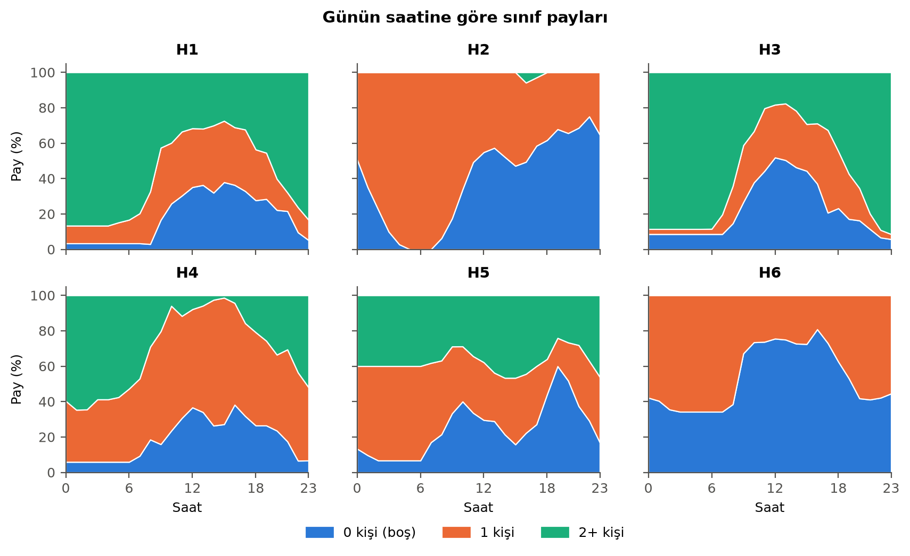

**Şekil 5.** Günün saatine göre sınıf payları (ev başına).

*Gözlem:* çok kişilik evlerde 2+ sınıfı gece yığılır:

| Ev | 2+ payı, gece 00–05 | 2+ payı, öğlen 11–16 |
|---|---|---|
| H1 | %86,4 | %31,0 |
| H3 | %88,6 | %22,7 |
| H4 | %60,7 | %5,6 |

Öğlen saatlerinde evlerin %25–75'i boştur.

*Önemi:* gece hem ışık kapalı (görüntü yok) hem de herkes evdedir. Model "karanlık = 2+ kişi" kısayolunu öğrenebilir; bu
kısayol, gece yalnız yaşayan biri için yanlış sonuç verir. *Modele etkisi:* finalde hata analizi saat dilimine göre ayrıca
raporlanacak; zaman bilgisi modele açık girdi olarak verilmeyecektir.

---

## 4. Modalitelerin Eşleştirilmesi ve Etiket Kalitesi (Kriter 4)

### 4.1 Eşleştirme anahtarı ve mantığı

Eşleştirme anahtarı **(ev, zaman damgası)**dır. Hedef ızgara etiket dosyasının 10 saniyelik satırlarıdır. İlişki her
modalite için farklıdır:

| Modalite | Ham sıklık | İlişki | Kural |
|---|---|---|---|
| Etiket | 10 sn | — (ızgaranın kendisi) | satır t = [t, t+10) |
| Ortam | 10 sn | bire bir | ham CSV zaten 10 sn ızgarasında; zaman damgasıyla doğrudan eşleşir (tekrar kayıt 0) |
| Ses | 10 sn | bire bir | dosya adındaki zaman 10 sn'ye yuvarlanır; aynı pencereye düşen ikinci dosya tekrar sayılır (0 adet) |
| Görüntü | 1 sn | bire çok → bire bir | pencereye düşen ~10 kareden pencere ortasına (5. sn) en yakın olanı seçilir |
| Zone etiketi | 1 sn | bire bir (seçilen kareye) | seçilen karenin zaman damgasıyla eşleşir |

Hub düzeyinde her ev 4–5 paralel kanal içerir; etiket ev düzeyinde olduğundan aynı etiket o pencerenin bütün hub'larına
uygulanır (bire çok).

**Eşleşme oranları** (ev × hub ayrıntısı Ek A):
- Ses: eşleşen 5.306.603 / 5.313.026 dosya (%99,88); ızgara dışı 6.423; bozuk 0.
- Görüntü: ızgara içi 38.810.467 / 40.848.391 kare (%95,0); hub-pencerelerin %64,1'inde bir kare seçilebildi.
  Izgara dışı kalan 2.037.924 karenin %98,6'sı (2.009.701) H2'dendir: H2'nin etiket dosyaları 13–29 Mart 2019'u
  kapsar, kameralar ise 12 Mart ve 30 Mart–2 Nisan'da da kayıt yapmıştır; etiketi olmayan bu günlerin kareleri
  düşer. Kalan 28.223 kare H1'dendir: etiket kaydı 25.12.2019 20:14'te biter, RS1–RS3 kameraları 22:46'ya kadar
  kayda devam eder. İki durum da figshare'deki zip'lerin içerik listesinden doğrulanmıştır (H2-RS1: 284.305 / 284.305,
  H1-RS1: 7.962 / 7.962 kare birebir).
- Ortam: ızgaradaki 6.084.425 hub-penceresinin %95,3'ünde (5.795.480) en az bir sensör ölçümü var; tekrar kayıt 0.

**Doğru eşleşmenin kanıtı:**
- **Ham dosya ↔ işlenmiş dizi:** `notebooks/vize_eda.ipynb` Bölüm 2, H1-RS2'nin 26.11.2019 17:00:00 penceresinde ham PNG,
  ham ses CSV'si, ham ortam satırı ve ham etiketi açar ve işlenmiş dizinin aynı satırıyla karşılaştırır. Kare piksel
  piksel, ses (log1p sonrası), ortam ve etiket birebir aynıdır (`assert`).
- **Örnek eşleştirme tablosu:** `reports/ornek_eslesme.csv`, her evden 10 dakikayı (60 pencere × bütün hub'lar,
  1.680 satır) listeler. Her satırda pencerenin başlangıcı, o pencereye bağlanan ham kare ve ses dosyasının adı, ortam
  değerleri ve etiket bulunur. Tablodaki 2.950 dosya adının tamamı `data/samples/` altındaki ham dosyalarda bulunmuştur.
- **Yazarların metadata'sı ile bağımsız karşılaştırma:** veri setiyle yayımlanan `Data_set_file_completeness.csv`
  her ev için bir hub'ın ses ve ortam doluluk oranını verir. Bizim ızgarada saydığımız oranlar altı satırın altısında
  yazarlarınkiyle aynıdır (en büyük fark 0,00; `reports/veri_ozeti.md`). Dosyalar eksiksiz okunmuş ve doğru pencereye
  yerleşmiştir.
- Şekil 1: aynı pencerenin dört kanalı.
- Şekil 15: farklı sensörlerden gelen kamera parlaklığı ve ışık değeri, eşleşme doğru olduğu için yüksek uyum gösterir;
  hatalı (kaymış) eşleşmede bu uyum düşerdi.
- Şekil 16: ışığın açılma anı, kamera parlaklığındaki artış ve kamerada insan görülmesi bir gün boyunca aynı saatlere denk gelir.

### 4.2 Etiketlerin kökeni ve kalitesi

- **Köken:** etiket, sakinlerin eve giriş-çıkışlarını telefondaki geo-fence uygulaması ve kâğıt imza listesiyle
  kaydetmesinden üretilmiştir; misafirler de kayda eklenmiştir. `occupied` (var/yok) yazarlar tarafından kamera
  görüntüleriyle doğrulanmıştır; `number` (kişi sayısı) ise yazarların ifadesiyle yalnız tahmin olarak kullanılmalıdır
  (Jacoby ve ark., 2021). Hedefimiz `number`'dan türetildiği için bu bir kısıttır; sakin sayısını aşan (misafir)
  değerler Bölüm 1.1'dedir.
- **İç tutarlılık:** `occupied = 1 ⇔ number > 0` koşulu altı evin hepsinde 0 tutarsızlıkla sağlanır.
- **Dış çapraz kontrol:** her kare için yazarların YOLOv5 ile ürettiği "karede insan var mı" (zone) etiketi bağımsız bir
  ikinci kaynaktır. Etiket "0 kişi" derken herhangi bir hub'ın karesinde insan görülen pencereler sayılmıştır (Şekil 6).

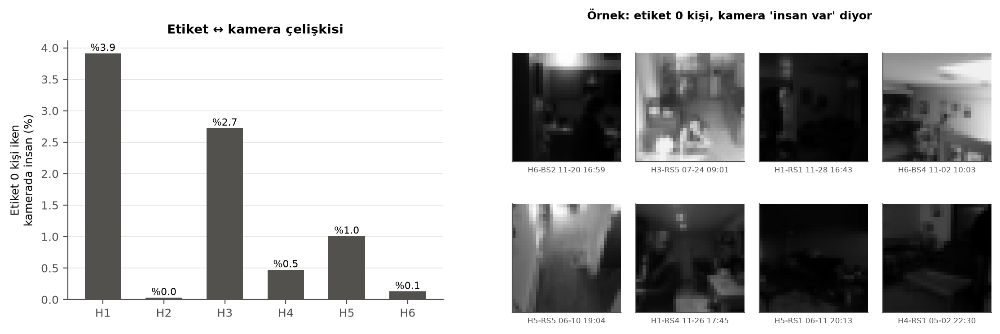

**Şekil 6.** Etiket ↔ kamera çelişkisi. Sol: etiketi "0 kişi" olan (ve en az bir zone etiketi bulunan) pencerelerde
kamerada insan görülme oranı. Sağ: çelişkili pencerelerden örnek kareler.

*Gözlem:*
- Çelişki oranı H1'de %3,9 (1.793 pencere), H3'te %2,7 (1.537), diğer evlerde %1'in altındadır.
- Örnek karelerin çoğu karanlık ve belirsizdir.

*Önemi:* çelişkilerin bir kısmı YOLO yanlış pozitifi (karanlık karede insan "görme"), bir kısmı gerçek etiket hatası
olabilir; iki kaynağın da hatalı olabildiği açıktır. *Modele etkisi:* etiket gürültüsü düşüktür (en kötü evde %3,9), ancak
finalde hata analizinde bu pencereler ayrıca işaretlenecektir. Zone etiketi yalnız kendi kamerasının görüş alanını
kapsadığından kişi sayısı için doğrudan ikinci etiket olarak kullanılamaz.

### 4.3 Eksik modalite analizi

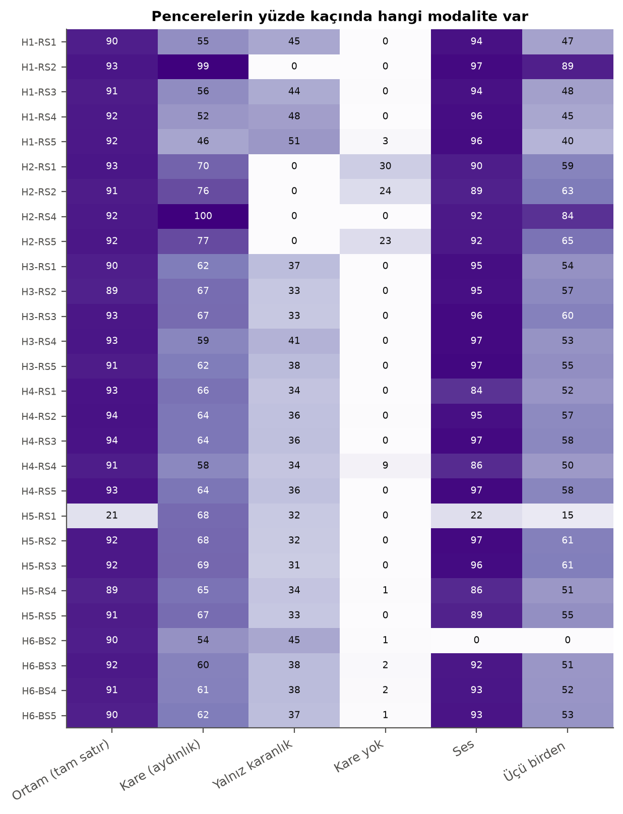

**Şekil 7.** Ev × hub için her modalitenin bulunduğu pencere yüzdesi. "Yalnız karanlık": kare yazarlarca karanlık diye
atılmış; "kare yok": ne kare ne karanlık kaydı var.

*Gözlem:*
- Ortalama olarak hub-pencerelerin %89,0'ında ortam satırı tam, %65,6'sında aydınlık kare, %87,4'ünde ses vardır.
- Üç modalitenin birlikte bulunduğu oran %53,3'tür.

**Eksiklik nedenleri:**

| Neden | Etkisi |
|---|---|
| Karanlık (gece ışık kapalı) | görüntü eksikliğinin büyük kısmı (%30,9) |
| H2 için karanlık liste yayımlanmamış | H2'de karanlık kareler "kare yok" sütununda görünür (%23–30); bunların ~%99'u 19:00–08:00 arası |
| Donanım kesintisi | H6 BS2'de hiç ses yok (%0); H5 RS1'de ortam ve ses ~%21–22 |
| Sistematik kısa sensör boşlukları | ortam verisi (Bölüm 5) |

*Önemi:* eksiklik rastgele değildir. Görüntü eksikliği geceyle, gece de 2+ sınıfıyla ilişkilidir (Şekil 5). Eksikliğin
kendisi sınıf hakkında bilgi taşır ve kısayol riski yaratır.

**Ele alma stratejisi:**
- Hiçbir pencere silinmez.
- Her modalite ve hub için ikili maske tutulur (`src/dataset.py`).
- Eksik kanalın değeri 0'dır ve maskeyle ayırt edilir.
- Finalde eğitim sırasında rastgele modalite düşürme (modality dropout) uygulanacak ve modelin belirli modalite
  kombinasyonlarındaki başarısı ayrı ayrı ölçülecektir.

---

## 5. Veri Temizleme ve Ön İşleme (Kriter 5)

### 5.1 Veri kalitesi sorunlarının belirlenmesi

Tespit edilen bütün sorunlar `docs/VERI_SORUNLARI.md`'de kök neden ve durumla kayıtlıdır; özet Tablo 9'dadır.
Sayısallaştırılan başlıca sorunlar:

| Sorun türü | Bulgu |
|---|---|
| Eksik veri | ortam ham hücrelerinin %6,92'si boş; görüntü ve ses eksikliği Bölüm 4.3 |
| Bozuk dosya | görüntüde 0 (boyutu farklı kare yok), seste 0 (sayısal olmayan/boş dosya yok) |
| Tekrar kayıt | ortamda 0, seste 0; görüntüde 0 (kamera saniyede 1 kare çeker, 10'dan fazla karesi olan pencere yok) |
| Aykırı değer | 128 nem okuması ~%3285; 3 sıcaklık okuması iç mekânda imkânsız (ör. −12,7 °C); 1.049 ışık okuması > 100.000 lux (en yüksek 319.774) |
| Kalite düşüklüğü | RS5 kutusunun nem sensörü takılı (H2–H5'te std 0,36–0,74, diğer hub'larda 3–33); gaz sensörleri taban değerde; 4 hub'da kamera parlaklığı ışıkla ilişkisiz (Bölüm 6.4) |
| Etiket sorunu | kişi sayısı doğrulanmamış; kamera ile %0,03–3,9 çelişki (Bölüm 4.2) |

### 5.2 Temizleme ve dönüştürme yöntemleri

Temel ilke: işlenmiş veri diskte ham hizalı hâlde kalır, temizleme okunurken uygulanır (`src/clean.py`). Böylece
öncesi/sonrası karşılaştırma her zaman yeniden üretilebilir ve bir kural değiştiğinde veri yeniden indirilmez.

**Tablo 4.** Modalite bazında ön işleme adımları.

| Modalite | Adım | Yöntem | Gerekçe |
|---|---|---|---|
| Hepsi | Zaman hizalama | 10 sn ızgara, pencere = [t, t+10) | etiketin sıklığı 10 sn; ortak örnek birimi |
| Görüntü | Kare seçimi | pencere ortasına en yakın kare | 10 sn içinde sahne nadiren değişir; ortadaki kare pencereyi en iyi temsil eder |
| Görüntü | Ölçekleme | /255 → [0, 1] | sinir ağı girdisi için standart; boyutlandırma gerekmez (hepsi 32×32) |
| Ses | Log dönüşümü | log1p (diskte), float16 | değer aralığı 0–3,5·10⁸, çarpıklık 51; float16 65.504'ü aşamaz |
| Ses | Normalizasyon | hub içi z-skoru | mikrofon kazancı hub'a göre farklı |
| Ortam | Aralık dışı | sıcaklık 0–45 °C, nem 0–100 %, ışık 0–10⁵ lux, eCO2 400–60.000 ppm, TVOC 0–60.000 ppb dışı → NaN | fiziksel olarak imkânsız okumalar sensör hatasıdır |
| Ortam | Takılı sensör | RS5 nemi → NaN | std < 1; ölçüm değil sabit değer |
| Ortam | Kısa boşluk | ≤ 6 pencere (1 dk) doğrusal ara değer | ortam ölçümü 1 dk içinde çok az değişir; uzun boşlukta değer uydurmak sahte veri olur |
| Ortam | Normalizasyon | hub içi z-skoru | hub'lar arası kalibrasyon ve kutu içi ısınma farkı (Şekil 11) |

### 5.3 Öncesi–sonrası karşılaştırmalar

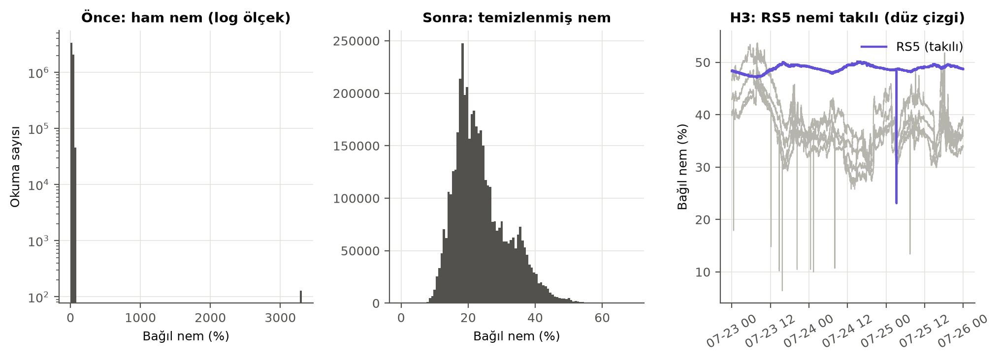

**Şekil 8.** Nem temizliği. Sol: ham nem (log ölçek), 128 okuma ~%3285'te. Orta: temizlenmiş nem. Sağ: H3'te RS5'in nemi
düz bir çizgi (takılı). *Gözlem:* aralık dışı kural yalnız 128 okumayı (geçerli nem okumalarının ~%0,002'si) siler; dağılımın
gövdesi değişmez. *Önemi:* tek bir 3285 değeri, z-skoru normalizasyonunda ortalama ve std'yi bozarak bütün hub'ın ölçeğini
kaydırırdı.

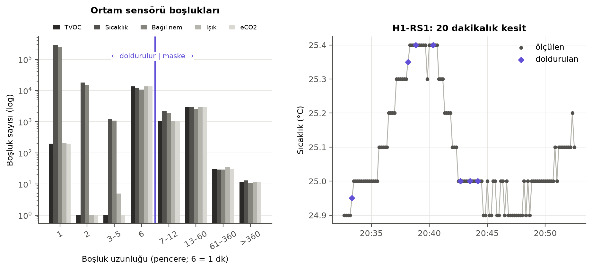

**Şekil 9.** Ortam boşlukları ve doldurma. Sol: sensör bazında boşluk uzunluğu dağılımı (log). Sağ: H1-RS1 sıcaklığında
20 dakikalık kesit; mor noktalar doldurulan değerler.

*Gözlem:*
- 5 sensörde toplam 653.466 boşluk vardır; %96,7'si 1 dakika veya daha kısadır.
- Sıcaklık ve nemde 289.026 tek pencerelik boşluk vardır (DHT22 sensörünün ara sıra okuyamaması).
- Işık ve gaz sensörlerinde boşluklar 6'nın katıdır (13.706 tanesi tam 1 dk); bu, kutunun 1 dakikalık bloklar hâlinde
  veri kaybettiğini gösterir.

*Önemi:* kısa boşlukların doldurulması gerçek eğilimi korur (sağ panel). *Modele etkisi:* RS5 dışındaki hub'larda beş
sensörü de dolu satır oranı **%89,5 → %96,1**'e çıkar.

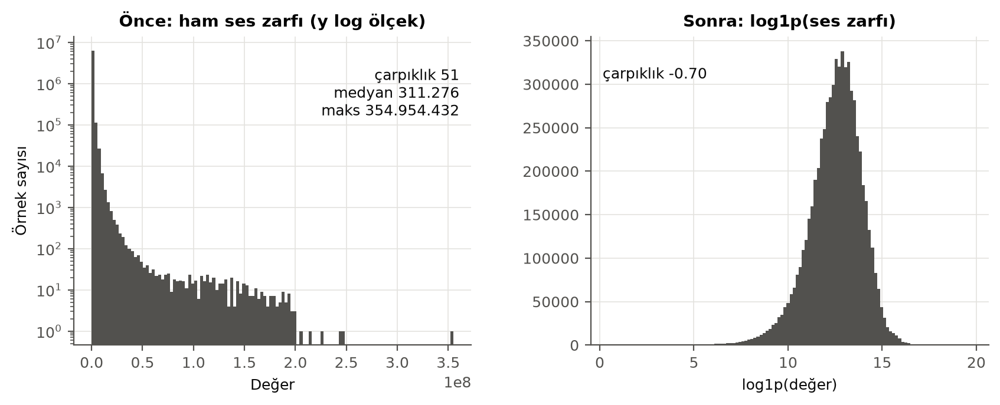

**Şekil 10.** Ses zarfı log dönüşümü. Sol: ham değerler (y log ölçek); sağ: log1p. *Gözlem:* ham dağılım aşırı sağa
çarpıktır (çarpıklık 50,9, medyan ~311.000, en yüksek ~355 milyon); log1p sonrası çarpıklık −0,7'dir. *Önemi:* ham ölçekte
birkaç çok büyük değer gradyanları domine ederdi. *Modele etkisi:* ses kodlayıcısı dengeli, yaklaşık simetrik bir girdi alır.

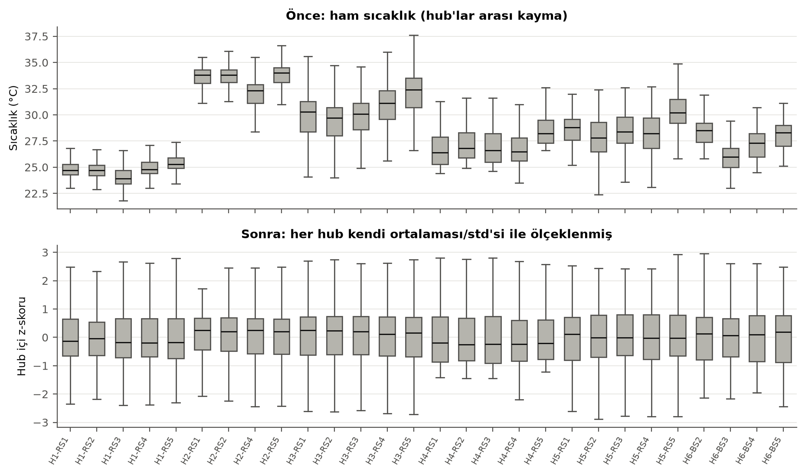

**Şekil 11.** Sıcaklık, hub bazlı normalizasyon öncesi (üst) ve sonrası (alt). *Gözlem:* ham medyanlar hub'lar arasında
23,9–34,0 °C arasındadır; Mart ayında ölçülen H2'de iç mekân 33 °C görünür ki bu, kutudaki Raspberry Pi'nin ısıtmasıdır.
Hub içi z-skoru sonrası bütün hub'lar aynı ölçeğe gelir. *Önemi:* normalizasyon olmasaydı model sıcaklıktan kişi sayısını
değil hangi hub'ın/evin verisi olduğunu öğrenirdi. *Modele etkisi:* z-skoru etiket kullanmadan her hub'ın kendi verisinden
hesaplanır; test evine de aynı şekilde uygulanabilir (Bölüm 7).

### 5.4 Temizleme kaynaklı bilgi kaybı

**Tablo 5.** Ortam sensörleri temizleme dökümü (birim: hücre = hub-pencere × sensör; toplam 30.422.125).

| Adım | Hücre | Toplamın %'si |
|---|---|---|
| Ham veride boş (NaN) | 2.105.487 | 6,921 |
| Aralık dışı → NaN (sıcaklık 3, nem 128, ışık 1.049) | 1.180 | 0,004 |
| Takılı RS5 nem sensörü → NaN | 901.575 | 2,964 |
| Kısa boşluk doğrusal doldurma (geri kazanılan) | 991.440 | 3,259 |
| Temizleme + doldurma sonrası kalan NaN (maskelenen) | 2.016.802 | 6,629 |

**Değerlendirme:**
- Aralık dışı kural toplamın on binde 0,4'ünü siler ve bunlar fiziksel olarak imkânsız okumalardır.
- En büyük kayıp RS5 neminin tamamen çıkarılmasıdır (%2,96). Aynı evde 3–4 başka hub'ın nemi korunduğundan ev düzeyinde
  nem bilgisi kaybolmaz.
- Görüntüde bilinçli bir kayıp vardır: pencere başına ~10 kareden 1'i kullanılır. Seçilen karenin %99,5'i tam pencere
  ortasındadır ve 32×32 sahnede 10 saniyede değişim azdır. Finalde birden fazla karenin kullanımı denenebilir.
- **Hiçbir pencere (örnek) silinmemiştir**; eksik değerler maskelenir. Örnek sayısı temizleme öncesi ve sonrasında
  1.311.925'tir.

---

## 6. Keşifsel Veri Analizi ve Görselleştirme (Kriter 6)

### 6.1 Modalite bazında görsel analiz

- **Görüntü:** gerçek örnek kareler Şekil 2'de, pencere başına kare sayısı Şekil 4'te.
- **Ses:** tipik ses zarfları ve sınıf dağılımı Şekil 14'te.
- **Ortam:** sensör değerlerinin sınıf dağılımı Şekil 12'de, gaz sensörü taban davranışı Şekil 13'te.

Ham örnek dosyalar `data/samples/` altındadır.

### 6.2 İstatistiksel dağılım analizi

**Tablo 6.** Seçilmiş değişkenlerin sınıf bazında medyanları ve tüm veri için ortalama ± std (hub'lar birleşik).
Tam tablo (n, ortalama, std, Q1, medyan, Q3, min, maks) `reports/ozet_istatistik.md`'de (Ek B).

| Değişken | 0 kişi medyan | 1 kişi medyan | 2+ kişi medyan | Tümü ort. ± std |
|---|---|---|---|---|
| Işık (lux) | 519 | 377 | 28 | 1.639 ± 5.505 |
| Kare parlaklığı (0–255) | 95,3 | 91,1 | 77,3 | 80,8 ± 34,5 |
| Sıcaklık (°C) | 28,0 | 28,4 | 27,3 | 28,2 ± 3,1 |
| Bağıl nem (%) | 19,3 | 20,8 | 26,2 | 23,8 ± 8,0 |
| Ses enerjisi (log1p) | 12,69 | 12,59 | 12,42 | 12,54 ± 0,87 |
| eCO2 (ppm) | 400 | 400 | 400 | 471,7 ± 400,1 |
| TVOC (ppb) | 0 | 0 | 0 | 21,9 ± 111,4 |

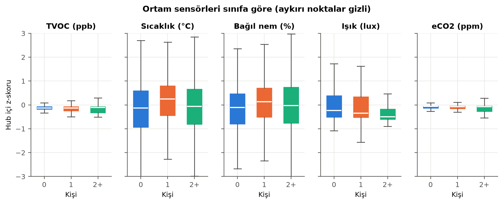

**Şekil 12.** Ortam sensörlerinin sınıfa göre dağılımı (hub içi z-skoru, kutu grafiği).

*Gözlem:*
- Işık sınıfları en iyi ayıran ortam değişkenidir: 2+ medyanı −0,50, 0 kişi −0,23 (z).
- Sıcaklık ve nemde fark küçüktür.
- eCO2 ve TVOC kutuları sınıflar arasında üst üste biner.

*Önemi:* ışık farkı, 2+ sınıfının geceye yığılmasının (Şekil 5) bir yansımasıdır; kişi sayısından çok günün saatini
ölçüyor olabilir. *Modele etkisi:* tek başına ortam modeli karışık (confounded) bir sinyal öğrenir; bu, multimodal
yaklaşımın gerekçesidir.

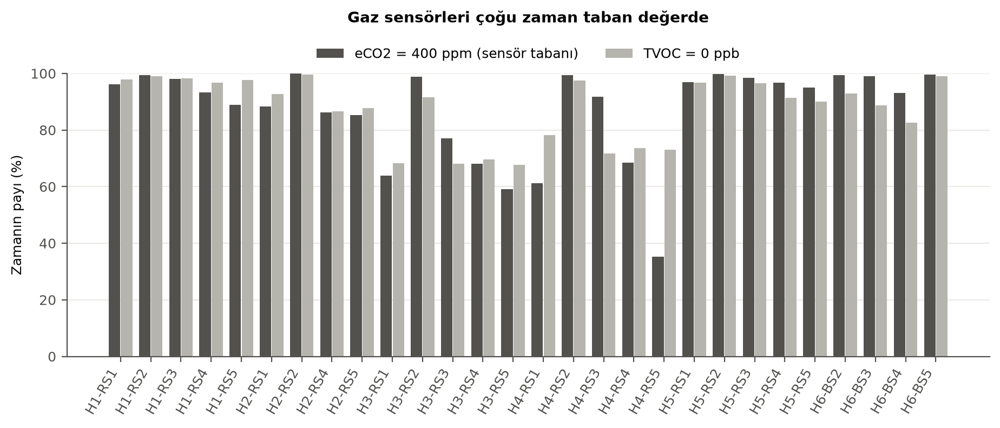

**Şekil 13.** Gaz sensörlerinin taban değerde geçirdiği zaman. *Gözlem:* eCO2 = 400 ppm (SGP30 sensörünün alt sınırı)
hub başına zamanın %35,3–100'ü, TVOC = 0 ise %67,7–99,7'sidir. *Önemi:* sensör düşük konsantrasyonları ayırt edemez;
değişken çoğu zaman sabittir. *Modele etkisi:* bu iki kanalın bilgi kapasitesi düşüktür; finalde ablasyonla
(kanal çıkararak) katkıları ölçülecektir.

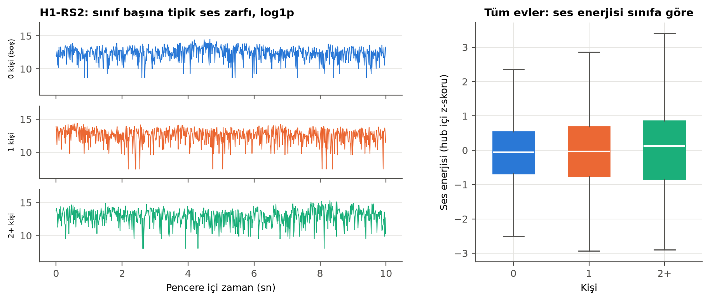

**Şekil 14.** Ses modalitesi. Sol: H1-RS2'den her sınıfın medyan enerjili (tipik) ses zarfı. Sağ: bütün evlerde hub içi
z-skorlu ses enerjisi.

*Gözlem:* sınıflar arası fark küçüktür; z-skoru medyanları −0,06 / −0,04 / 0,12. 2+ sınıfı hafifçe daha yüksek ve daha
yaygındır (Q1–Q3: −0,84 ile 0,85).

Birleşik ham değerlerde ise 2+ medyanı en düşüktür (Tablo 6). Bu, hub'lar birleştirildiğinde ortaya çıkan bir
bileşim etkisidir: 2+ penceresi daha çok sessiz kazanımlı hub'lardan ve gece saatlerinden gelir. Hub içi normalizasyonun
gerekliliğini de gösterir.

*Önemi ve modele etkisi:* ses tek başına zayıf bir modalitedir. Değeri, görüntünün olmadığı gece pencerelerinde
tamamlayıcı bilgi vermesindedir.

### 6.3 Modaliteler arası ilişkilerin analizi

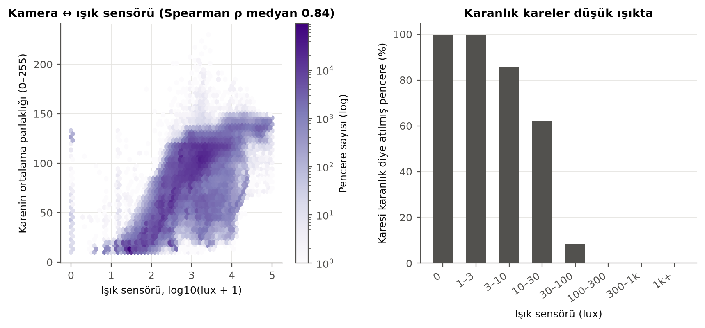

**Şekil 15.** Kamera ↔ ışık sensörü. Sol: ışık (log) ile karenin ortalama parlaklığı (hexbin, bütün hub'lar). Sağ: ışık
düzeyine göre karesi "karanlık" diye atılmış pencere oranı.

*Gözlem:*
- İki bağımsız sensör güçlü biçimde ilişkilidir: hub başına Spearman ρ medyanı 0,84, en yüksek 0,98.
- Karanlık kare oranı < 3 lux'ta %99,5, 10–30 lux'ta %62, 100 lux üstünde %0'dır.

*Önemi:* modaliteler arasındaki uyum zamansal eşleştirmenin doğru olduğunu kanıtlar. Ayrıca görüntü eksikliğinin
mekanizmasını sayısal olarak açıklar: kare, ışık ~30 lux'un altına indiğinde kaybolur. *Modele etkisi:* görüntü yokken ışık
sensörü "karanlık" bilgisini zaten taşır; görüntü maskesi ile ışık kanalı birbirinin yerine geçebilir.

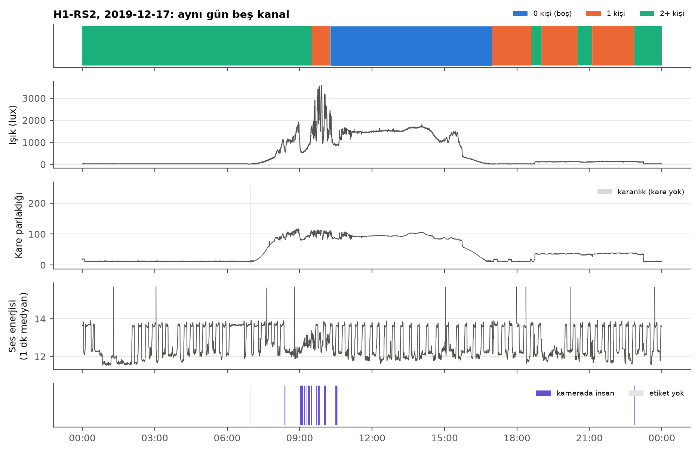

**Şekil 16.** Aynı gün, aynı hub (H1-RS2, 17.12.2019): etiket, ışık, kare parlaklığı, ses enerjisi (1 dk medyan) ve
kamerada insan (zone) alt alta.

*Gözlem:*
- 07:00'de ışık ve kare parlaklığı birlikte artar.
- Kamerada insan görülen anların yoğunlaştığı 08:30–10:30 aralığı, etiketin 2+ → 1 (09:31) ve 1 → 0 (10:16) geçişlerini kapsar.
- Ev boşken (10:16–16:59, ~2.400 pencere) kamerada insan yalnız 33 pencerede görülür (Bölüm 4.2'deki çelişki türü).
- Ses enerjisinde yaklaşık 17 dakikada bir tekrarlayan kare dalga vardır (otokorelasyon tepesi, `notebooks/05_ses_analizi`). Bu muhtemelen ısıtma/klima döngüsüdür (doğrulanmamış
  hipotez) ve doluluktan bağımsız görünür.

*Önemi:* modaliteler aynı olayı farklı yönlerden gösterir. Sesteki periyodik arka plan, sınıf ayrımının neden zayıf
olduğunu açıklar. *Modele etkisi:* finalde sesten kayan medyanla arka planın çıkarılması denenecektir.

Üçüncü modaliteler arası analiz Şekil 1 (eşleştirilmiş örnek kartları), dördüncüsü Şekil 6'dır (etiket ↔ kamera).

### 6.4 Aykırı durum ve örnek olay analizi

Şekil 15'teki hub bazlı uyum değerleri dört hub'ın normal davranıştan saptığını gösterir: ρ < 0,3 (H6 BS5 0,02, H2 RS4
0,15, H5 RS3 0,17, H3 RS1 0,25). En uç vaka H6 BS5 ayrıntılı incelenmiş ve aynı evdeki normal bir hub (H6 BS4) ile
karşılaştırılmıştır (Şekil 17).

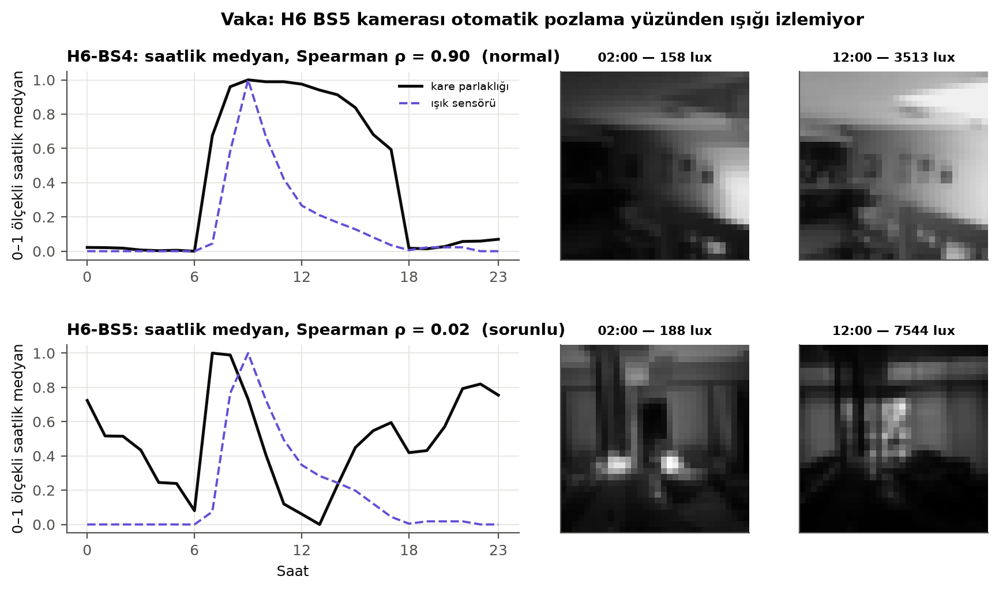

**Şekil 17.** Vaka analizi: normal hub (H6 BS4, ρ = 0,90) ve sorunlu hub (H6 BS5, ρ = 0,02). Sol: saatlik medyan kare
parlaklığı ve ışık (0–1 ölçekli). Sağ: aynı hub'ların 02:00 ve 12:00'deki kareleri.

*Gözlem:*
- BS4'te parlaklık ışığı izler: gece düşük, gündüz yüksek.
- BS5'te ise parlaklık gece öğlenden yüksektir.
- Kareler nedeni gösterir: gece BS5'in odasında lambalar yanar ve kamera otomatik pozlamayla parlak bir görüntü üretir.
  Öğlen pencereden gelen ters ışık nedeniyle kamera pozlamayı kısar ve odanın büyük kısmı karanlık görünür.
- Kamera odanın içini, ışık sensörü ise kutunun bulunduğu noktadaki ışığı ölçer; iki ölçüm aynı şey değildir.

*Önemi:* "kare parlaklığı" gibi elle çıkarılmış basit özellikler bazı hub'larda yanıltıcıdır. *Modele etkisi:* modele ham
kare verilecek ve görüntü kodlayıcısı sahne içeriğini öğrenecektir. Bu hub'lar hata analizinde ayrıca izlenecektir.

Diğer aykırı/hatalı örnek karşılaştırmaları:
- Etiket–kamera çelişkili pencereler (Şekil 6).
- İmkânsız nem değerleri ve takılı sensör (Şekil 8).

### 6.5 Bilimsel yorum: verinin güçlü ve sınırlı yönleri

**Güçlü yönler:**
- Büyük ölçek: 1,31 milyon etiketli pencere, 6 ev, 152 gün.
- Dengeli üç sınıf (Tablo 3).
- Yüksek doğrulukta zaman eşleştirmesi: karelerin %99,5'i tam pencere ortasında, ses %99,9 eşleşme.
- Bozuk ve tekrar kayıt yok.
- Modaliteler arası güçlü fiziksel uyum (ρ = 0,84) ve gerçek, sistematik eksik modalite yapısı. Bu, projenin
  "eksik modaliteye dayanıklılık" sorusu için doğal bir test ortamıdır.

**Sınırlı yönler:**
- Kişi sayısı etiketi doğrulanmamıştır (Bölüm 4.2).
- Sınıf, günün saatiyle güçlü biçimde karışıktır (Şekil 5).
- 2+ sınıfı yalnız 4 evden gelir; H2 ve H6 test katlarında yoktur.
- Gaz sensörleri bilgi taşımaz (Şekil 13).
- Ses arka plan döngüsüne baskındır (Şekil 16).
- Bazı kameralar otomatik pozlama nedeniyle ışığı izlemez (Şekil 17).
- Örneklem 6 evle ve tek bir şehirle sınırlıdır.

**Uygulanamayan analizler:** ses için dalga formu ve spektrogram analizi yapılamamıştır, çünkü veri setinde ham ses dalgası
yoktur. Yazarlar gizlilik için yalnız 800 değerlik ses zarfını yayımlamıştır; bu nedenle analiz zarf ve enerji üzerinden
yürütülmüştür.

---

## 7. Modellemeye Hazırlık ve Veri Bölme Stratejisi (Kriter 7)

### 7.1 Bölme ve veri sızıntısını önleme

Stratified 5-fold (rastgele katlama) bu veri için **uygun değildir**, iki nedenle:

1. **Zamansal bağımlılık:** ardışık iki pencerenin etiketi %99,947 aynıdır. Etiket segmentlerinin medyan süresi 0 kişi
   için 143 dk, 1 kişi için 74 dk, 2+ için 364 dk'dır (Şekil 18). Rastgele bölmede bir test penceresinin 10 saniye
   öncesi ve sonrası eğitimde olur; model neredeyse aynı örneği ezberleyerek yüksek ama yanıltıcı skor alır.
   Bunu ölçtük (`src/split.py`, `leakage_table`): pencere bazında rastgele %80/%20 bölmede test pencerelerinin
   %95,99'unun 10 sn komşusu eğitimdedir ve hiçbir şey öğrenmeyen "en yakın eğitim penceresinin etiketini söyle" hilesi
   %99,95 doğruluk alır. Bizim bölmemizde bu komşu oranı doğrulamada da testte de %0'dır; doğrulamada hile %57,76'ya
   düşer (en yakın eğitim penceresi ≥ 6 saat uzakta), leave-one-home-out testinde ise uygulanamaz.
2. **Ev kimliği:** aynı evin odaları, kamera açıları ve sakinleri hem eğitimde hem testte olursa görüntü modeli kişiyi
   değil odayı tanır (Şekil 2).

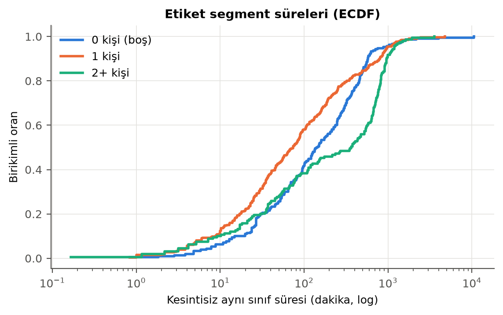

**Şekil 18.** Kesintisiz aynı sınıf sürelerinin birikimli dağılımı (log ölçek). *Gözlem:* 701 segment; segmentlerin
çoğu saatler sürer. *Önemi:* zaman komşuluğu ciddi bir sızıntı kaynağıdır. *Modele etkisi:* grup tabanlı (ev) ve zamansal
bölme zorunludur.

**Seçilen strateji** (`src/split.py`):
- **Dış döngü, leave-one-home-out (6 kat):** her katta bir ev test, kalan beş ev eğitimdir. Bir pencerenin bütün
  modaliteleri tek bir satırda saklandığından aynı örneğin görüntü, ses ve ortam verisi her zaman aynı kattadır.
- **İç doğrulama, zamansal:** her eğitim evinin son %20'lik zaman dilimi doğrulamadır. Eğitimle doğrulama arasındaki 6 saat
  atılır (gap). 6 saat, 2+ segmentlerinin medyan süresine (364 dk) karşılık gelir ve sınırdaki aynı segmentin iki tarafa
  düşmesini engeller.
- **Normalizasyon:** hub içi z-skoru etiket kullanmaz; test evinin istatistiği kendi verisinden hesaplanır (gözetimsiz
  uyarlama). Daha katı alternatif olarak test evinin yalnız ilk 24 saati kullanılabilir; finalde ikisi karşılaştırılacaktır.
- **Metrik:** H2 ve H6 test katlarında 2+ sınıfı olmadığından (%0,4 ve %0) bu katlarda sınıf bazında F1, altı katın
  birleşik karışıklık matrisi ve 2+ bulunan katlarda macro-F1 raporlanacaktır.

**Tablo 7.** Katlara göre örnek sayıları (0 / 1 / 2+).

| Kat | Test evi | Eğitim | Doğrulama | Gap | Test |
|---|---|---|---|---|---|
| 1 | H1 | 244.351 / 326.681 / 207.864 | 107.951 / 89.376 / 67.057 | 10.800 | 45.921 / 58.866 / 153.058 |
| 2 | H2 | 239.747 / 295.405 / 332.516 | 101.867 / 90.121 / 94.589 | 10.800 | 58.150 / 88.189 / 541 |
| 3 | H3 | 237.452 / 328.610 / 194.470 | 94.971 / 89.220 / 54.002 | 10.800 | 65.800 / 55.632 / 180.968 |
| 4 | H4 | 269.232 / 316.953 / 288.395 | 102.063 / 85.804 / 91.798 | 10.800 | 26.928 / 72.499 / 47.453 |
| 5 | H5 | 258.803 / 315.870 / 306.819 | 108.857 / 108.102 / 73.074 | 10.800 | 31.606 / 49.124 / 48.870 |
| 6 | H6 | 189.010 / 230.366 / 332.516 | 36.811 / 88.972 / 95.130 | 10.800 | 174.562 / 153.758 / 0 |

### 7.2 Modele uygun veri yapısı

`src/dataset.py` her örneği (ev, pencere) sabit şekilli bir sözlük olarak döndürür. Hub sayısı evden eve değiştiği için
(4–5) hub'lar 5 sabit yuvaya dizilir; olmayan yuva maskelenir.

**Tablo 8.** Bir örneğin girdi biçimi (ör. H1, pencere 100.000, 07.12.2019 13:46:40, etiket 2+, kişi sayısı 4).

| Anahtar | İçerik | Şekil | Tip | Ön işleme |
|---|---|---|---|---|
| `img` | 5 hub'ın birer karesi | (5, 32, 32) | float32 | /255 |
| `aud` | 5 hub'ın ses zarfı | (5, 800) | float32 | log1p + hub içi z |
| `env` | 5 hub × 5 sensör | (5, 5) | float32 | temizleme + ≤1 dk doldurma + hub içi z; NaN → 0 |
| `mask_img` | kare var mı | (5,) | bool | — |
| `mask_aud` | ses var mı | (5,) | bool | — |
| `mask_env` | sensör değeri gerçek mi | (5, 5) | bool | — |
| `y` | sınıf | skaler | int | `min(number, 2)` |

Örnekte RS5 yuvasında nem maskesi 0'dır (takılı sensör çıkarıldı). Dört hub'lı H6'dan bir örnekte 5. yuvanın bütün
maskeleri 0, BS2'nin ses maskesi 0'dır (`reports/veri_yapisi.md`).

**Füzyon hazırlığı:**
- **Tek modalite** taban çizgileri: yalnız `img`, yalnız `aud`, yalnız `env`. Her biri kendi maskesiyle doğrudan kullanılabilir.
- **Erken füzyon:** ortam ve ses özetlerinin tek vektörde birleştirilmesi.
- **Ara / geç füzyon:**
  - Kodlayıcılar: görüntü için küçük CNN, ses için 1B CNN, ortam için MLP.
  - Hub ve modalite gömmeleri maskeli ortalama ile birleştirilir; maske eksik modaliteyi hesaptan çıkarır.
  - Eksik modaliteye dayanıklılık modality dropout ile eğitilir.

**Finalden önce giderilecek sorunlar:**
- Saat–sınıf karışıklığı (değerlendirme saat dilimine göre ayrılmalı).
- Ses arka planı (arka plan çıkarma).
- Gaz sensörlerinin katkısı (ablasyon).
- Otomatik pozlamalı hub'lar (hata analizi).
- Etiket–kamera çelişkili pencereler (işaretleme).

---

## 8. Sunum, Kod ve Yeniden Üretilebilirlik (Kriter 8)

**Ortam:** Python 3.12, `uv` ile sanal ortam. Kütüphaneler (sürümler sabit, `requirements.txt`): numpy 2.5.4,
pandas 3.1.1, pillow 13.0.0, matplotlib 3.11.2, pyarrow 26.0.1, jupyter.

**Teslim edilenler:**
- Teknik rapor (bu belge) ve ekleri (`reports/`).
- Kod: `src/` altındaki altı betik.
- Notebook'lar (`notebooks/`, çıktılarıyla kayıtlı, veri indirilmeden okunabilir): özet sunum notebook'u `vize_eda.ipynb` ve aşama aşama sekiz notebook: `01_veri_kaynagi_ve_yukleme`, `02_modalite_eslestirme`, `03_etiket_analizi`, `04_goruntu_analizi`, `05_ses_analizi`, `06_ortam_sensorleri_ve_temizleme`, `07_eksik_modalite`, `08_bolme_ve_model_verisi`. Her biri ilgili kriterin hesaplarını `src/` kodunu çağırarak canlı yapar.
- Veri erişimi: veri 50,9 GB olduğu için depoya konmamıştır. figshare'den aşağıdaki adımlarla yeniden indirilip
  üretilir. Örnek eşleştirme bilgisi `reports/ornek_eslesme.csv`'dedir.

**Çalıştırma sırası:**

```
uv venv --python 3.12 .venv && uv pip install -p .venv -r requirements.txt
.venv/bin/python src/download.py                  # küçük dosyalar (~190 MB)
cd data && for z in raw/*_{GROUNDTRUTH,ENVIRONMENTAL,ZONELABELS,DARKIMAGES}.zip; do unzip -oq "$z" -d interim/$(basename $z .zip | cut -d_ -f1); done; cd ..
.venv/bin/python src/build.py all --fetch         # büyük zip'ler: indir → işle → sil (~51 GB indirme, 15 GB kalıcı)
.venv/bin/python src/eda.py                       # 18 şekil + tablolar → reports/
.venv/bin/python src/split.py                     # bölme planı
.venv/bin/python src/dataset.py                   # veri yapısı örneği
.venv/bin/jupyter lab notebooks/vize_eda.ipynb    # sunum notebook'u (Run All)
```

**Kod yapısı:**

| Dosya | Görevi |
|---|---|
| `src/download.py` | veri alma |
| `src/build.py` | eşleştirme |
| `src/clean.py` | temizleme kuralları |
| `src/eda.py` | analiz ve grafikler |
| `src/split.py` | bölme |
| `src/dataset.py` | model girdisi |

**Önemli parametreler:**
- pencere 10 sn;
- kare seçimi pencerenin 5. saniyesi;
- boşluk doldurma ≤ 6 pencere;
- aralık sınırları `src/clean.py:VALID`;
- doğrulama payı %20, gap 6 saat.

**Kendi kendini doğrulama:** `src/clean.py`, `src/split.py` ve `src/dataset.py` çalıştırıldığında kendi testlerini
(assert) yürütür. Rapordaki bütün sayılar `reports/*.md` ve `reports/eda_numbers.json` dosyalarından gelir; bunlar da
koddan üretilir.

---

## 9. Kısa Değerlendirme ve Final Planı

**Öne çıkan bulgular:**
1. Veri yönerge koşullarını fazlasıyla sağlar (1,31 milyon örnek, dengeli 3 sınıf).
2. Görüntü eksikliği rastgele değildir: geceyle, gece de 2+ sınıfıyla ilişkilidir.
3. Işık sensörü ile kamera güçlü uyumludur ve bu uyum eşleştirmenin doğruluğunu kanıtlar.
4. Ses ve gaz sensörleri tek başına zayıftır.
5. Zamansal bağımlılık ve ev kimliği nedeniyle ev bazlı bölme zorunludur.

**Sınırlılıklar:** doğrulanmamış kişi sayısı etiketi, saat–sınıf karışıklığı, tek şehirden 6 ev, iki evde 2+ sınıfının
olmaması.

**Final aşaması planı:**
1. Tek modalite taban çizgileri.
2. Maskeli ara füzyon modeli.
3. Modality dropout ile eksik modaliteye dayanıklılık.
4. Modalite kombinasyonlarına ve saat dilimine göre ayrıntılı değerlendirme.
5. Gaz sensörü ve ses arka plan çıkarma ablasyonları.
6. Yazarların füzyon yaklaşımıyla nitel karşılaştırma (Tan ve ark., 2022).

---

**Tablo 9.** Veri sorunları özeti (ayrıntı ve kök neden: `docs/VERI_SORUNLARI.md`).

| Sorun | Ölçek | Yapılan | Durum |
|---|---|---|---|
| İmkânsız nem/sıcaklık/ışık okumaları | 128 / 3 / 1.049 okuma | aralık dışı → NaN | ele alındı |
| RS5 nem sensörü takılı | 901.575 okuma | NaN | ele alındı |
| Ortam kısa boşlukları | 653.466 boşluk, %96,7'si ≤ 1 dk | ≤ 1 dk doğrusal doldurma, kalanı maske | ele alındı |
| Sıcaklık mutlak değeri güvenilmez | hub medyanları 23,9–34,0 °C | hub içi z-skoru | ele alındı |
| Ses değer aralığı ve çarpıklık | çarpıklık 50,9 | log1p | ele alındı |
| Karanlık kareler yok | hub-pencerelerin %30,9'u | maske (eksik modalite) | ele alındı |
| H2 karanlık listesi yayımlanmamış | H2'de %23–30 kare yok | maske | kabul |
| Ses yok/az hub'lar | H6 BS2 %0, H5 RS1 %22 | maske | ele alındı |
| Gaz sensörleri tabanda | %35–100 | final ablasyonu | açık |
| Kamera parlaklığı ışıkla ilişkisiz | 4 hub, ρ < 0,3 | ham kare kullanımı, izleme | kabul |
| Ses arka plan döngüsü | tüm evler, sınıf farkı küçük | final: arka plan çıkarma | açık |
| Saat–sınıf karışıklığı | H1 2+ gece %86,4 / öğlen %31,0 | saat bazlı değerlendirme | kabul |
| Kişi sayısı doğrulanmamış | kamera çelişkisi %0,03–3,9 | kısıt olarak raporlandı | ele alındı (ölçüldü) |
| 2+ tek kişilik evlerde yok | H2 541, H6 0 | metrik seçimi | kabul |
| Kişi sayısı sakin sayısını aşıyor (misafir) | H3 42.526, H2 541 pencere | 2+ sınıfında toplandı | kabul |
| Etiketsiz günlerin kareleri | 2.037.924 kare (H2 %98,6, H1 kalanı) | düştü; zip içerik listesiyle doğrulandı | kabul |

---

## Kaynaklar

Jacoby, M., Tan, S. Y., Henze, G., & Sarkar, S. (2021). A high-fidelity residential building occupancy detection dataset.
*Scientific Data*, 8, 280. https://doi.org/10.1038/s41597-021-01055-x

Tan, S. Y., Jacoby, M., Saha, H., Florita, A., Henze, G., & Sarkar, S. (2022). Multimodal sensor fusion framework for
residential building occupancy detection. *Energy and Buildings*, 111828. https://doi.org/10.1016/j.enbuild.2021.111828

IEA (2025). *Energy Efficiency 2025 – Buildings*. International Energy Agency. https://www.iea.org/reports/energy-efficiency-2025/buildings

Lu, J., Sookoor, T., Srinivasan, V., Gao, G., Holben, B., Stankovic, J., Field, E., & Whitehouse, K. (2010). The smart
thermostat: using occupancy sensors to save energy in homes. *ACM SenSys 2010*, 211–224. https://doi.org/10.1145/1869983.1870005

Pang, Z., Guo, M., O'Neill, Z., Smith-Cortez, B., Yang, Z., Liu, M., & Dong, B. (2024). Long-term field testing of the
accuracy and HVAC energy savings potential of occupancy presence sensors in a single-family home. *Energy and Buildings*.
https://www.osti.gov/pages/biblio/2479675

HPDmobile veri seti, figshare koleksiyonu 5364449. https://figshare.com/collections/_/5364449 (CC0).

---

## Ekler

- **Ek A:** Ev × hub × modalite eşleşme tablosu: `reports/veri_ozeti.md`.
- **Ek B:** Tam özet istatistik tabloları: `reports/ozet_istatistik.md`.
- **Ek C:** Temizleme dökümü: `reports/temizleme_dokumu.md`.
- **Ek D:** Bölme planı: `reports/bolme_plani.md`.
- **Ek E:** Model veri yapısı: `reports/veri_yapisi.md`.
- **Ek F:** Veri sorunları kaydı: `docs/VERI_SORUNLARI.md`.
- **Ek G:** Örnek eşleştirme tablosu (ham dosya adı ↔ pencere ↔ etiket): `reports/ornek_eslesme.csv`.
- **Ek H:** Sunum notebook'u (ham ↔ işlenmiş eşleşme kanıtı ve bütün şekiller): `notebooks/vize_eda.ipynb`.
- **Ek I:** Sınıf gerekçesi (kişi sayısı, ev sakinleri, kamerada görülme oranı): `reports/sinif_gerekcesi.md`.
- **Ek J:** Aşama aşama notebook'lar: `notebooks/01_…` – `08_…` (veri yükleme, eşleştirme, etiket, görüntü, ses, ortam ve temizleme, eksik modalite, bölme ve model verisi).
